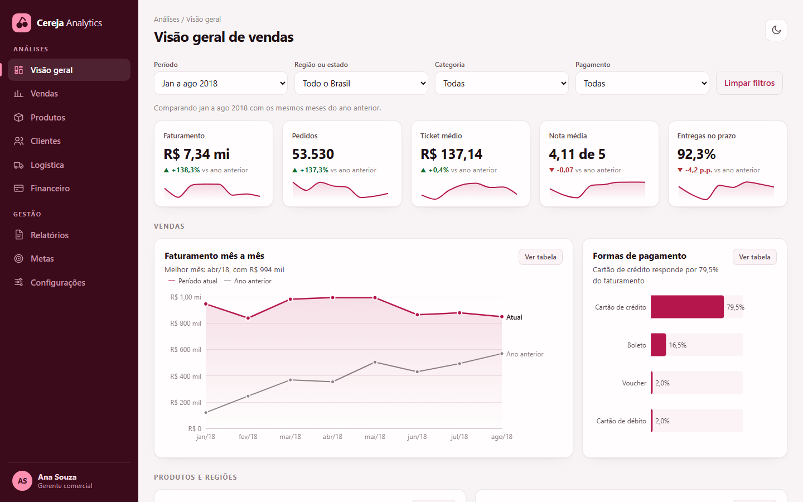

# Cereja Analytics, painel de vendas

**Veja funcionando:** https://deborahdalonso.github.io/sales-dashboard-demo/

Painel interativo de vendas de e-commerce construído com **dados reais e públicos da Olist**: cerca de 98 mil pedidos de lojas brasileiras, de janeiro de 2017 a agosto de 2018.

## O que dá para ver

- **Indicadores do período**: faturamento, pedidos, ticket médio, nota média e entregas no prazo, cada um com minigráfico e comparação com os mesmos meses do ano anterior.
- **Vendas**: faturamento mês a mês contra o ano anterior e a participação de cada forma de pagamento.
- **Produtos e regiões**: as 10 categorias que mais faturam e um mapa do Brasil com o faturamento por estado.
- **Entrega e satisfação**: como o atraso derruba a nota do cliente, de 4,30 no prazo para 1,66 com 8 dias ou mais de atraso, e os estados onde a entrega demora mais.

## Como usar

- Os filtros de período, região ou estado, categoria e pagamento valem para o painel inteiro.
- Clicar numa categoria, num estado do mapa ou numa forma de pagamento também filtra tudo. Clicar de novo desfaz.
- Cada gráfico tem o botão **Ver tabela**, com os números completos.
- O botão no canto superior direito alterna entre tema claro e escuro.
- No celular, o menu lateral abre pelo botão de três linhas.

## Como foi feito

- **Tratamento dos dados em Python (pandas)**: um registro por pedido, agregado por mês, estado, categoria e forma de pagamento, num arquivo compacto que o navegador filtra na hora.
- **Painel em HTML, CSS e JavaScript**, com Apache ECharts para os gráficos e o mapa.
- **Paleta validada** para contraste e daltonismo nos dois temas.
- **Página estática** no GitHub Pages, sem servidor e sem custo.

Este repositório contém só a versão publicada. A empresa, o menu e a usuária são fictícios; os dados são reais.

## Créditos

- Dados: [Brazilian E-Commerce Public Dataset by Olist](https://www.kaggle.com/datasets/olistbr/brazilian-ecommerce), licença CC BY-NC-SA 4.0.
- Mapa dos estados: [click_that_hood](https://github.com/codeforgermany/click_that_hood), licença MIT.

Desenvolvido por [Deborah Dalonso](https://www.linkedin.com/in/deborah-dalonso-482099138).
